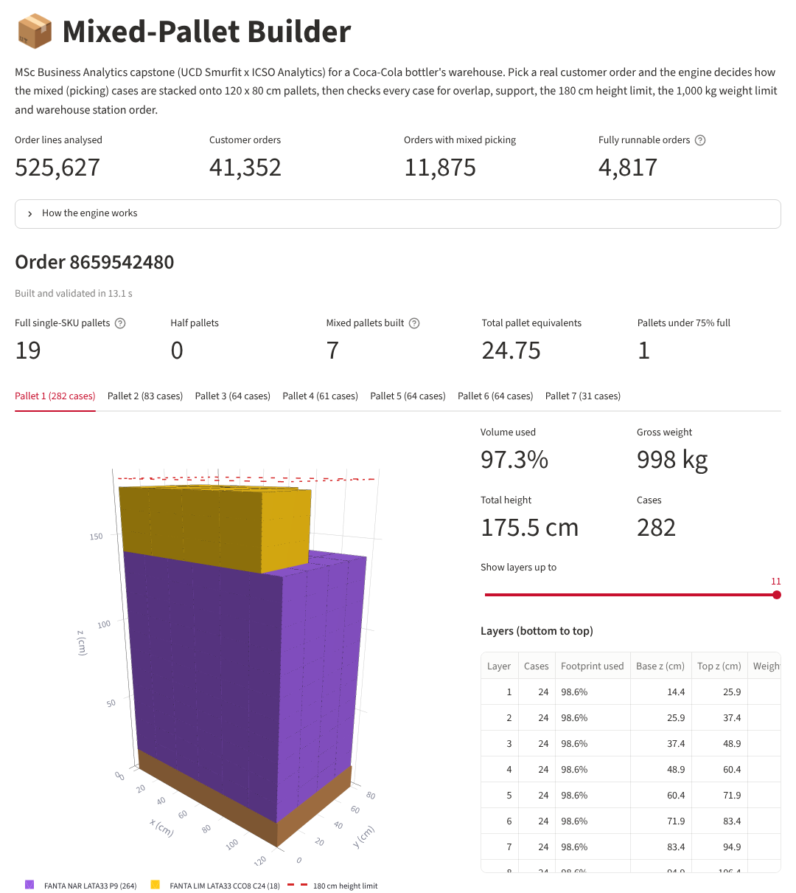

# Coca-Cola Mixed-Pallet Builder

**MSc Business Analytics capstone, UCD Michael Smurfit Graduate Business School, in partnership with ICSO Analytics**

### ▶ [Open the live app](https://palletization-capstone.streamlit.app)

No install needed. Pick a real customer order (or build your own), press **Build pallets**, and explore every mixed pallet in 3D.



---

## The problem

A Coca-Cola bottler's warehouse ships thousands of customer orders. Large order lines leave as full single-product pallets, but the leftover "picking" cases from many products have to be stacked together onto mixed pallets by hand. How those cases are stacked decides how many pallets (and trucks) an order needs, and whether the pallet is stable and safe.

The goal was a planner that builds mixed pallets that are **physically valid** and **use fewer pallets** than the existing approach.

## What the engine does

1. **Splits the order** into full pallets, half pallets and leftover picking cases.
2. **Sorts picking cases by warehouse station order**, which also gives a sensible heavy-and-stable-first stacking order. Allergen products are kept apart.
3. **Plans compact layers** per product, testing normal and rotated orientations, rows, columns and shelf combinations, and keeps the pattern with the most cases and least wasted area.
4. **Validates every case exactly:** inside the 120 x 80 cm footprint, no overlaps, at least 70% of each case's base supported, top at or under 180 cm, pallet under 1,000 kg.
5. **Falls back to case-by-case placement** when a full layer does not fit, and opens a new pallet only when nothing valid remains.
6. **Audits the full solution independently** before export. If any check fails, nothing is exported.

Product data is never guessed: if a SKU has no validated case dimensions or weight, the engine stops and reports it.

## Results

| | Pallets on benchmark order |
|---|---:|
| ICSO baseline | 6 |
| Intermediate hybrid (V3) | 7 |
| **Final system** | **5** |

On the benchmark order, 300 of 300 cases were placed with zero overlaps. The engine ships with 61 passing unit tests.

Coverage limit: 83 of 523 picking SKUs had no usable physical specification in the source data, so orders containing them cannot be planned. The live app lists the 4,817 orders that are fully covered.

## Repository layout

| Folder / file | What it is |
|---|---|
| `streamlit_app.py` | The web app (live link above). Replaces the original desktop window. |
| `palletization_engine/` | The planning engine, validation, unit tests, input data and the technical handoff notes (`PALLETIZATION_HANDOFF.md`). |
| `palletization_engine/inputs/` | Order lines (gzipped, unpacked automatically on first run) and SKU master files. |
| `3d_visualiser_ai_studio/` | Standalone React 3D visualiser built in Google AI Studio, for inspecting exported placement files. |
| `app_data/` | Showcase and pre-timed order lists used by the app. |

## Run it locally

```bash
git clone https://github.com/BillJ30/Palletization-Capstone.git
cd Palletization-Capstone
pip install -r requirements.txt
streamlit run streamlit_app.py
```

Run the unit tests:

```bash
cd palletization_engine
gunzip -k inputs/dataset_logistico_lineas.csv.gz   # only needed once
python -m unittest discover -p "test_*.py"
```

## Team

- **Mohamad Bilal:** report structure and drafting, problem definition, data and business requirements, managerial insights, data-quality and coverage investigation, algorithm design input (layer towering, hard constraints), and the idea for the 3D visualisation tool
- **Alexandre Gallais:** algorithm development, implementation and evaluation
- **Saif Rizvi:** literature review and research context

Supervisors: Dr. Peter Keenan and Prof. Angel A. Juan (UCD Smurfit). Industry partner: ICSO Analytics.

**Tools:** Python, pandas, Plotly, Streamlit, React (Google AI Studio). AI coding assistants (Claude Code, Codex, ChatGPT) were used during development, with all outputs reviewed and tested by the team.
